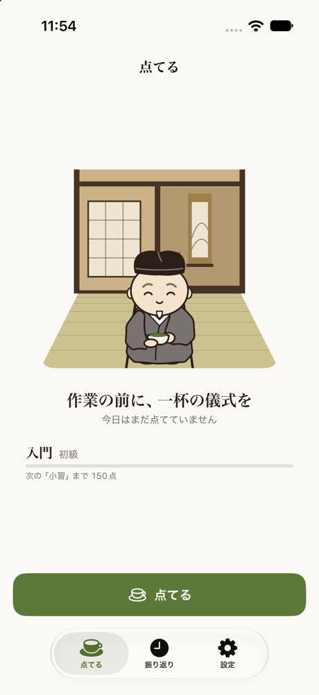
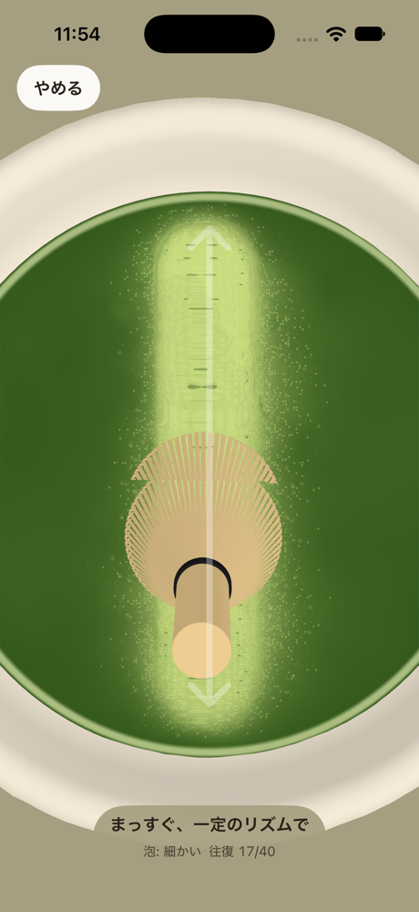
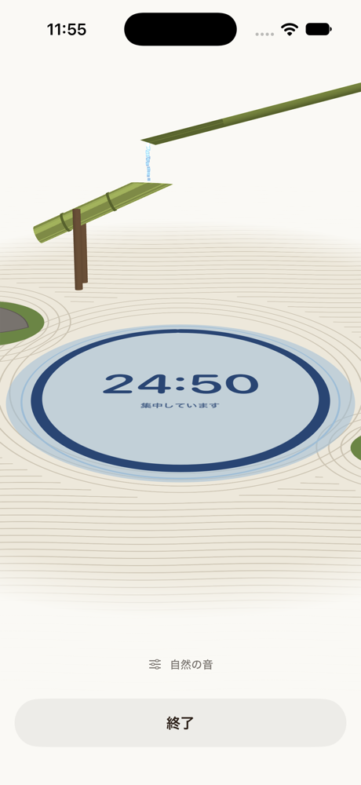
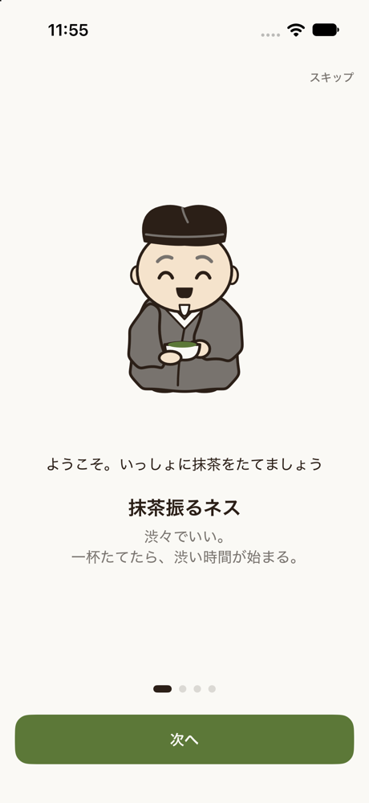

# 抹茶振るネス

<!--
このREADMEはSPAJAM2026の提出用テンプレートです。
各項目を埋めてください。項目の削除・見出しの変更はしないでください。
上の見出しの「（ここにアプリ名を書く）」は、アプリ名に書き換えてください。
記入の締切は2日目12:30（技術仕様書と同時刻）です。
締切時刻をもって、リポジトリへの書き込みを停止します。

※ リポジトリのDescription（右上の歯車から編集）にもアプリ名を記入してください。
-->

## 概要

<!-- アプリの概要を2〜3行で記入してください -->

机に置いた iPhone を茶碗に、指を茶筅に見立てて抹茶を点てる、作業前の「儀式」アプリです。
奥と手前をまっすぐ往復し、くるっと仕上げ、茶碗(iPhone)を90°ずつ2回まわすと、所作のていねいさが「集中の目安」として点数になり、泡もきめ細かくなります。
点てたあとは、ししおどしの集中タイマーで、勉強や仕事へ切りかえます。

## メンバーと各担当範囲

| 名前 | 担当範囲 |
| --- | --- |
| 山脇翔太 | コーディング(アプリの実装) |
| 渡邊賢信 | プレゼン作成、リサーチ |
| 大村尚輝 | ペルソナ分析、アイデア出し |
| 冨樫颯太 | デザイン |
| 前林慶敬 | 要件定義書の作成、アイデア出し、一部バックエンド |

## 使用言語と動作環境

<!--
例：
- 言語：Swift 5.9 / TypeScript 5.4
- 動作環境：iOS 17以上（iPhone 15 Pro で確認）
- バックエンド：Node.js 20 / Cloud Run
-->

- 言語：Swift(SwiftUI)
- 動作環境：iOS 26 以上の iPhone
- バックエンド：なし(通信なしで動く。記録は端末の中だけ)

## 利用しているライブラリ・ミドルウェアとその利用目的

<!--
例：
- Firebase Authentication：ユーザー認証
- Realm：ローカルデータの永続化
-->

- SceneKit・Metal:3Dの茶碗と、抹茶の泡の描画
- Core Motion・Core Haptics:茶碗を回す動きの検出と、茶筅の手触り
- Foundation Models:点て方の講評(端末内のAI)
- App Intents:アクションボタンやショートカットから「一服する」
- Rive(RiveRuntime):案内役キャラクター「りきゅうさん」のアニメーション
- Unity:茶碗・茶筅・ししおどし・抹茶の缶の3Dモデル作成
- SwiftData・UserNotifications:記録の保存、決めた時刻の通知

## 利用しているサービスとその利用目的

<!--
例：
- Google Maps Platform：地図表示と経路検索
- AITalk WebAPI：読み上げ音声の生成
-->

- TestFlight:実機への配信と動作確認
- Wikimedia Commons:自然の音の素材(川・風・鳥・ししおどし。CC0・パブリックドメイン・CC BY-SA。作者名はアプリの設定画面に記載)
- Mobbin:UIの参考調査

## 利用している生成AIサービスとその利用目的

<!--
SPAJAMでは生成AIの利用を歓迎しています。ユニークな使い方はポジティブに評価されます。
コーディング支援に使った場合も、ここに記入してください。

例：
- Claude Code：実装全般のペアプログラミング
- Gemini API：アプリ内での要約機能
-->

- Claude Code：実装全般のペアプログラミング、ドキュメント作成
- ChatGPT:アプリアイコンとキャラクターのデザイン、Rive アニメーションの制作、素材の書き出し
- Foundation Models(Apple、端末内):アプリ内での、点て方の講評の生成

## 技術的に工夫した点・苦労した点

<!-- 審査で重視される項目です。具体的に記入してください -->

### 工夫した点

1. 指の往復のまっすぐさとリズムを数式で採点し、ていねいに点てるほど泡が細かくなるようにした
   - 集中の目安 = 0.7 × 点てる + 0.15 × 仕上げ + 0.15 × 回す
   - 点てる = 0.45 × まっすぐさ + 0.35 × リズム + 0.2 × 回数
2. 泡は液の流れに乗って全体に広がり、場所によってムラが出る。濃い緑から、淡い抹茶色の泡へ変わる
3. 泡の描画を GPU(Metal のシェーダー)へ移し、処理時間を約 1/10 にして、茶筅が指に遅れなくなった(水面の処理 1 コマ平均 9〜24ms → 1.4〜2.5ms。シミュレーターで計測)
4. 茶碗・茶筅・ししおどし・抹茶の缶を、Unity で 3D モデルとして作った
5. タイマーのししおどしは、竹筒に水が溜まると傾き、水たまりに水を落として「カコン」と鳴る。水が落ちる場所・波紋・音のタイミングを計算で合わせた

### 苦労した点

1. 泡が自然に見えるまで、何度も作り直した(「炭酸みたい」「規則正しすぎる」などの意見を受けて)
2. 振動・茶碗を回す動き・音は実機でしか確かめられず、TestFlight で配っては実機で直す、をくり返した
3. ししおどしの竹筒の向き、水の落ちる場所、音のタイミングがそろうまで、調整をくり返した

## デモ

<!-- スクリーンショットやデモ動画のリンクがあれば記入してください（任意） -->

| 点てる(待機) | 点てる | 集中タイマー | はじめの説明 |
| --- | --- | --- | --- |
|  |  |  |  |
